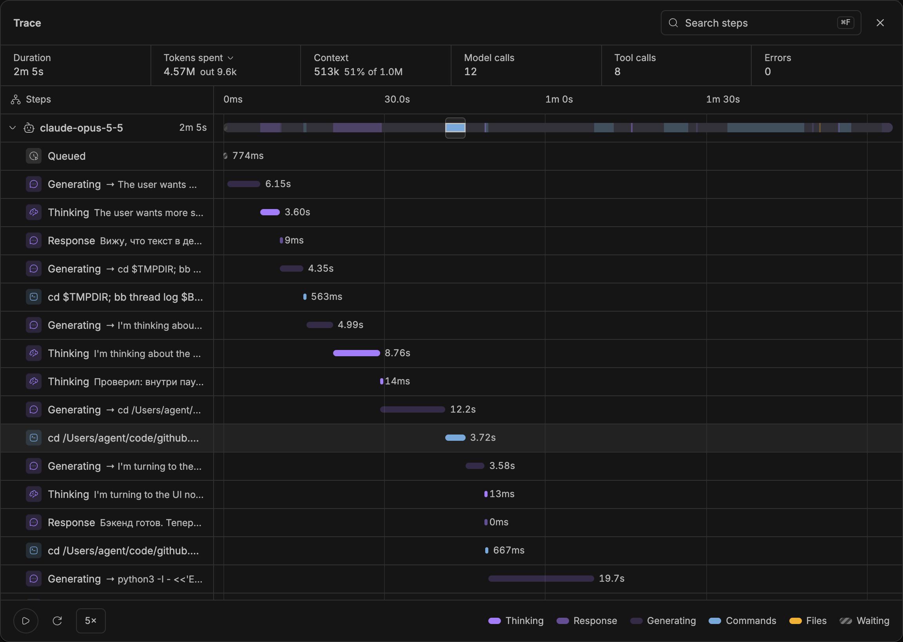
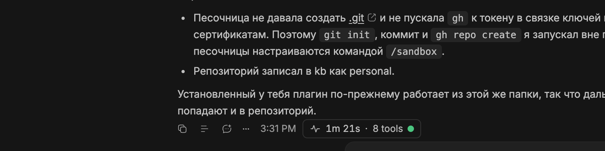
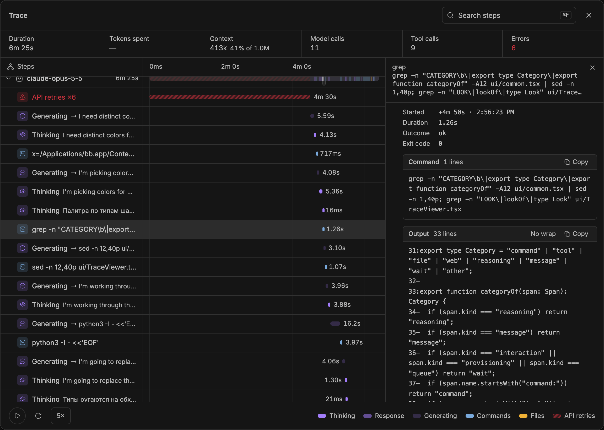
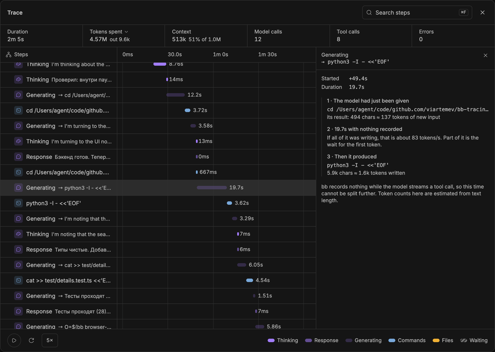
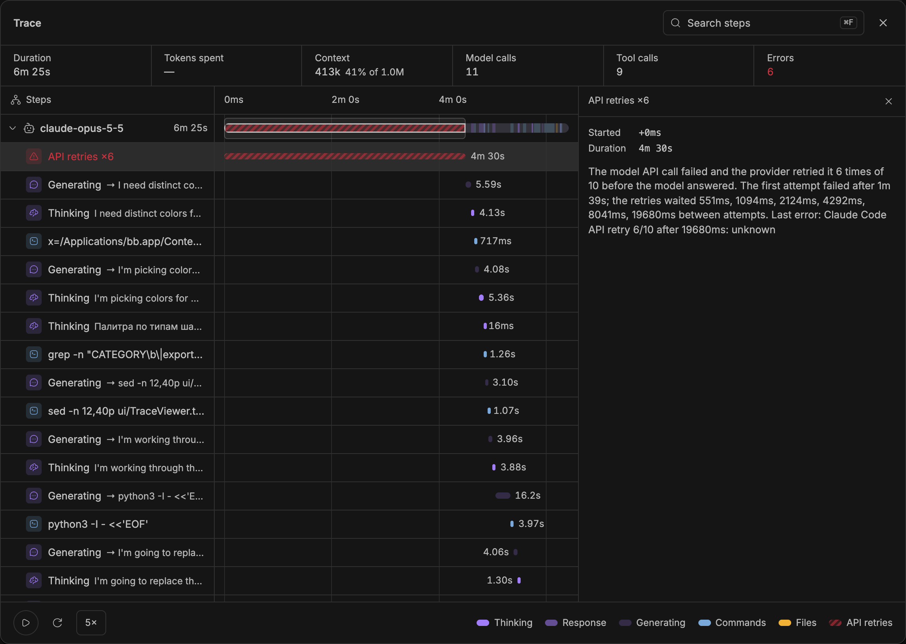
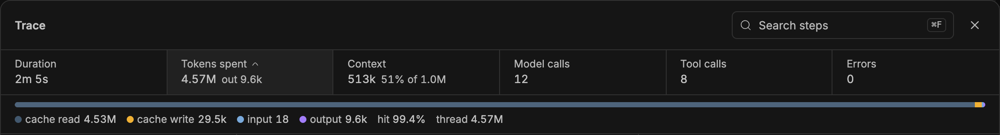
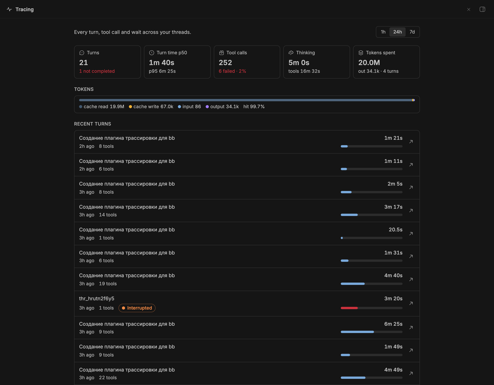

<div align="center">

# Tracing for BB

**English** · [Русский](README.ru.md)

**See where every second of an agent turn went.**

A trace under every answer: each command, tool call, thinking block and API retry on one timeline, what the step actually did, and what the turn cost in tokens.


-blue)

[Install](#install) · [What you get](#what-you-get) · [How it works](#how-it-works) · [CLI](#cli) · [Settings](#settings) · [Limitations](#limitations)

</div>



*Captured from the running plugin, tracing the turns that built it. Hovering a step lights up its place on the overview ribbon.*

## Why

An agent turn that takes four minutes is a black box: the chat shows a few
collapsed commands and a final answer. Was it the tests? The model thinking?
A flaky API? Tracing for BB turns each turn into a timeline you can read,
modelled on [OpenBot](https://openbot.run)'s trace view and log format.

- **A trace chip under every answer.** Duration, tool count, a live dot while the turn runs, red when something failed.
- **Every step on one time grid.** Thinking, responses, commands, tool calls, file changes and waits, one color per kind.
- **The silences explained.** Time no event covers becomes a *Generating* step, and failed API calls become an *API retries* step, instead of empty space.
- **Open any step.** The full command and its output, a tool's arguments and result, a file diff, or the thinking text.
- **Token spend per turn.** Cache reads, cache writes, uncached input and output, apart from how full the context is.
- **Everything stays on your machine.** Spans are NDJSON files in the plugin's data directory; step contents are read from BB's own history, never copied.

## What you get

### A trace under every answer



The chip sits in the action row of the last answer of each turn. Click it to open the trace viewer.

### Every step, opened up



Each row shows the real command, file or tool call. Select it for the step's
timing, exit code, the full command with **Copy**, its output with **Wrap**,
a tool's arguments and result, or a file's diff. Search steps with
<kbd>⌘F</kbd>, filter by kind, and replay the turn with a moving playhead at
1–25×.

### No more mystery gaps

BB records a tool call only once the model has finished writing its
arguments. Writing a 400-line file therefore shows up as a long silence
followed by a 30 ms file change. The viewer names that time and explains it
from its edges: what the model had just read, and what it produced.



When the provider's API calls fail, the silence is not the model at all.
The viewer reads BB's `provider/error` events and shows the retries:



### Where the tokens went



*Tokens spent* is what the turn cost; *Context* is how full the window was
when it ended. Most of the volume of an agent turn is the context re-read
from the prompt cache on every step; the cache hit rate shows how well that
worked.

### All threads at a glance



The **Tracing** page in the sidebar sums the last hour, day or week: turn
time p50/p95, tool failures, thinking time, token spend, and recent turns
across threads. Click a turn to open its trace; the arrow goes to the thread.
Below, sparklines of the BB server's memory, CPU and event-loop delay.

## Install

Requires **BB 0.48+**.

```sh
bb plugin install git:https://github.com/viartemev/bb-tracing.git --subdirectory bb-plugin-tracing
```

BB downloads dependencies, builds the plugin and enables it. Tracing starts
with the next turn; earlier history is not backfilled.

<details>
<summary><strong>Install from a local checkout</strong></summary>

```sh
git clone https://github.com/viartemev/bb-tracing
cd bb-tracing/bb-plugin-tracing
npm install --include=dev
bb plugin install .
```

After editing sources: `bb plugin build && bb plugin reload tracing`.

</details>

## How it works

| Where it comes from | What it becomes |
| --- | --- |
| A thread's event log, read incrementally when BB announces new events | `turn`, `tool`, `reasoning`, `message`, `interaction` and `provisioning` spans |
| `thread/tokenUsage/updated`, sent just before a turn completes | The turn's token spend (`tok*` attributes) |
| `provider/error` events inside the turn's time window | *API retries* steps in the viewer |
| Lifecycle events (`message.queued`, `turn.failed`, …) | `queue`, `error` and `thread` spans |
| `process.memoryUsage`, `cpuUsage`, event-loop delay, every minute | `resources.ndjson` samples |

Spans land in `trace.ndjson` and samples in `resources.ndjson`, in
`<BB data dir>/plugins/tracing/logs/` (`bb tracing path`). Each file
rotates into `<file>.1` at 5 MB. The first five fields of a span are
OpenBot's (`at`, `kind`, `name`, `durationMs`, `outcome`), so tools written
for its logs read these too:

```json
{"at":"2026-11-03T12:24:30.112Z","kind":"tool","name":"command:python3","durationMs":3720,"outcome":"ok","threadId":"thr_…","turnId":"…-t2","attrs":{"seq":2041,"exitCode":0}}
```

<details>
<summary><strong>Privacy</strong></summary>

- Nothing leaves the machine; the plugin makes no network calls.
- By default a span stores the program or tool name, never its arguments.
  `detail: full` adds the first 200 characters of each command and turn errors.
- Step contents (commands, output, diffs, thinking) are not copied into the
  trace files. Each span keeps the `seq` of its event, and the viewer reads
  the content from BB's thread history when you open the step.

</details>

## CLI

The same data from a terminal, and for agents through the bundled skill:

| Command | Shows |
| --- | --- |
| `bb tracing summary [--since 24h] [--kind tool] [--thread thr_…]` | Count, errors, p50, p95, max and total per span name |
| `bb tracing turns [--lines 3] [--self]` | A text waterfall of the latest turns |
| `bb tracing tail [--lines 20] [--kind …]` | The latest spans |
| `bb tracing resources [--lines 10]` | Per-minute RSS, heap, CPU, event-loop p99/max |
| `bb tracing path` | Where the trace files live |

Add `--json` to `summary`, `tail` and `resources` for machine-readable output.

## Settings

**Settings → Plugins → Tracing**, or `bb plugin config tracing set <key> <value>`:

| Setting | Default | Effect |
| --- | --- | --- |
| `enabled` | `true` | Record traces |
| `detail` | `names` | `full` also stores short command previews and turn errors |
| `maxFileMb` | `5` | Size at which each file rotates |
| `sampleResources` | `true` | Sample the BB server once a minute |

## Limitations

- Turns are traced from installation on. Token spend is captured as a turn
  ends, so turns that finished before an update show "—".
- BB records nothing while the model streams a tool call, so a *Generating*
  step cannot be split into waiting and writing. Its token figures are
  estimates from text length; the per-turn spend is exact.
- Resource samples cover the BB server process, not the agents' own processes.

## Development

```sh
cd bb-plugin-tracing
npm install --include=dev
npm test            # node --test, 28 tests
npm run typecheck
```

Backend in `server.ts` and `src/` (the span tracker is pure and tested), UI
in `ui/`. More in the [plugin README](bb-plugin-tracing/README.md).

---

Independent community plugin for [BB](https://getbb.app). Trace format and
viewer inspired by [OpenBot](https://openbot.run); not affiliated with either.
