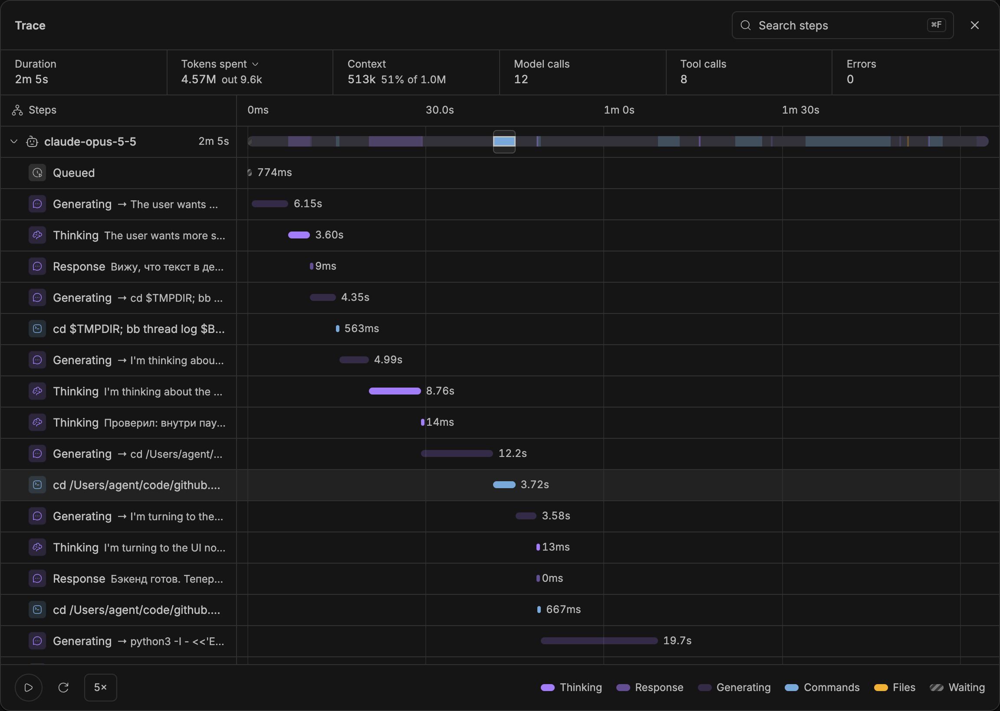
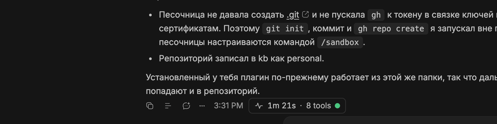
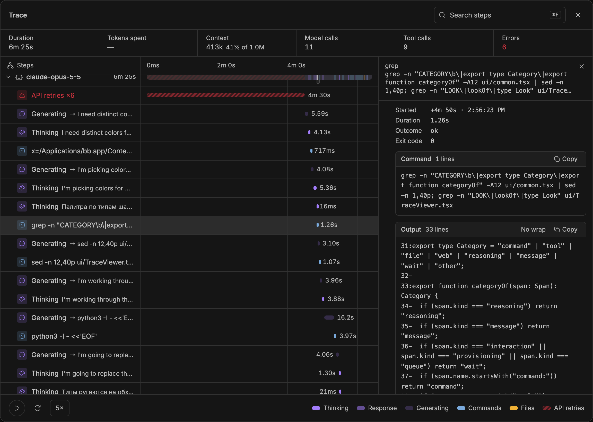
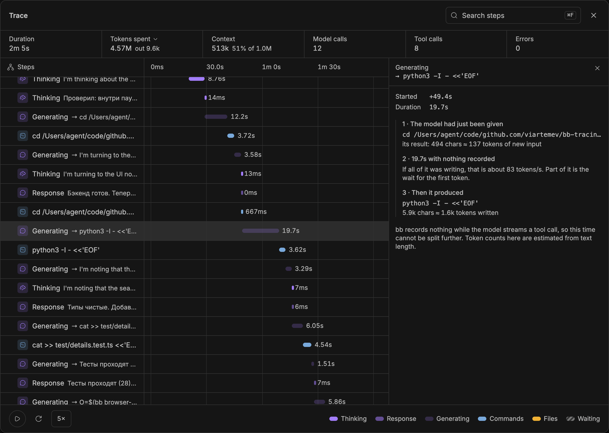
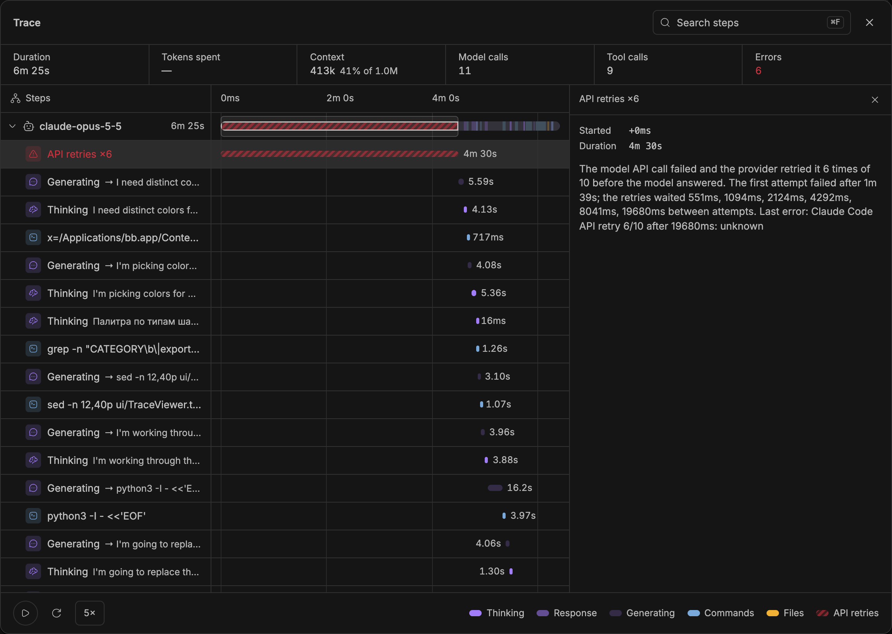
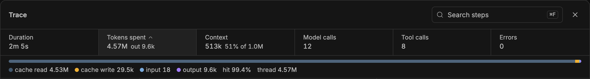
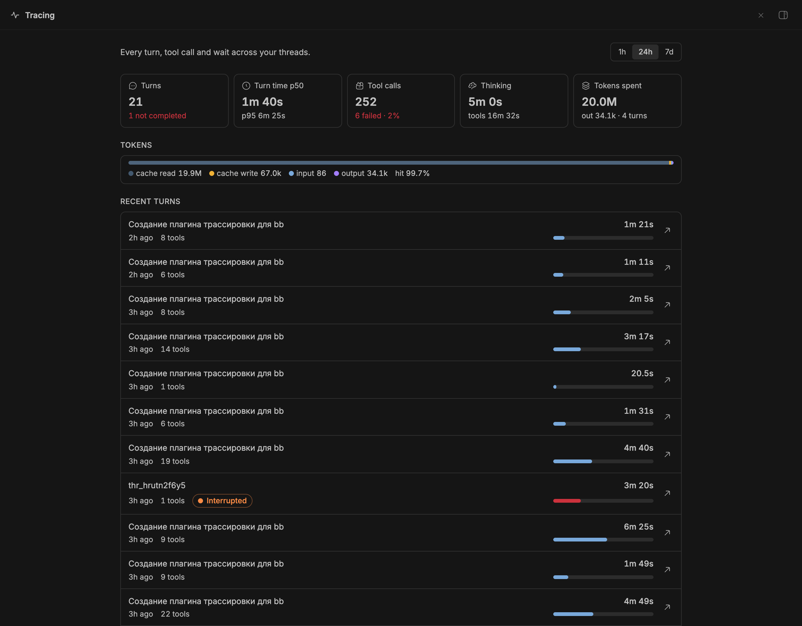

<div align="center">

# Tracing для BB

[English](README.md) · **Русский**

**Видно, куда ушла каждая секунда работы агента.**

Трейс под каждым ответом: каждая команда, вызов инструмента, блок размышлений и ретрай API на одной шкале времени, что именно сделал шаг и во сколько токенов обошёлся turn.


-blue)

[Установка](#установка) · [Что внутри](#что-внутри) · [Как устроено](#как-устроено) · [CLI](#cli) · [Настройки](#настройки) · [Ограничения](#ограничения)

</div>



*Снято с работающего плагина на turn'ах, в которых он сам и писался. При наведении на шаг подсвечивается его место на общей ленте.*

## Зачем

Turn агента на четыре минуты — чёрный ящик: в чате видно пару свёрнутых
команд и итоговый ответ. Это тесты так долго шли? Модель думала? API
падал? Tracing для BB превращает каждый turn в шкалу времени, которую можно
прочитать. За основу взяты просмотрщик трейсов и формат логов
[OpenBot](https://openbot.run).

- **Бейдж трейса под каждым ответом.** Длительность, число инструментов, живая точка, пока turn идёт, и красная, если что-то упало.
- **Все шаги на одной сетке времени.** Размышления, ответы, команды, вызовы инструментов, изменения файлов и ожидания, у каждого типа свой цвет.
- **Объяснённые паузы.** Время, которое не покрывает ни одно событие, становится шагом *Generating*, а упавшие запросы к API — шагом *API retries*, вместо пустоты.
- **Любой шаг можно раскрыть.** Полная команда и её вывод, аргументы и результат инструмента, diff файла или текст размышлений.
- **Расход токенов за turn.** Чтение и запись кэша, вход без кэша и выход, отдельно от заполненности контекста.
- **Всё остаётся на твоей машине.** Спаны лежат в NDJSON-файлах в папке плагина; содержимое шагов читается из истории BB и никуда не копируется.

## Что внутри

### Трейс под каждым ответом



Бейдж стоит в строке действий последнего ответа каждого turn'а. Клик открывает окно трейса.

### Каждый шаг раскрывается



В каждой строке — настоящая команда, файл или вызов инструмента. Выбери
шаг, чтобы увидеть время, код выхода, полную команду с **Copy**, её вывод с
**Wrap**, аргументы и результат инструмента или diff файла. Поиск по шагам —
<kbd>⌘F</kbd>, фильтр по типу и воспроизведение turn'а бегущей линией на
скорости 1–25×.

### Никаких загадочных пустот

BB записывает вызов инструмента только когда модель целиком дописала его
аргументы. Поэтому запись файла на 400 строк выглядит как долгая тишина и
потом изменение файла за 30 мс. Просмотрщик называет это время и объясняет
его по краям: что модель только что прочитала и что потом написала.



Когда падают запросы к API провайдера, тишина — это вообще не модель.
Просмотрщик читает события `provider/error` из истории BB и показывает ретраи:



### Куда ушли токены



*Tokens spent* — сколько стоил turn; *Context* — насколько заполнено окно
контекста на его конец. Почти весь объём turn'а агента — это контекст,
заново прочитанный из кэша промпта на каждом шаге; доля попаданий в кэш
показывает, насколько хорошо это сработало.

### Все треды на одной странице



Страница **Tracing** в сайдбаре подводит итоги за час, день или неделю:
p50/p95 длительности turn'ов, ошибки инструментов, время размышлений, расход
токенов и последние turn'ы по всем тредам. Клик по turn'у открывает его
трейс, стрелка ведёт в тред. Ниже — графики памяти, CPU и задержки event
loop сервера BB.

## Установка

Нужен **BB 0.48+**.

```sh
bb plugin install git:https://github.com/viartemev/bb-tracing.git --subdirectory bb-plugin-tracing
```

BB скачает зависимости, соберёт плагин и включит его. Запись начинается со
следующего turn'а; прошлая история не подтягивается.

<details>
<summary><strong>Установка из локальной копии</strong></summary>

```sh
git clone https://github.com/viartemev/bb-tracing
cd bb-tracing/bb-plugin-tracing
npm install --include=dev
bb plugin install .
```

После правок: `bb plugin build && bb plugin reload tracing`.

</details>

## Как устроено

| Откуда | Во что превращается |
| --- | --- |
| Лог событий треда, читается инкрементально, когда BB сообщает о новых событиях | Спаны `turn`, `tool`, `reasoning`, `message`, `interaction`, `provisioning` |
| `thread/tokenUsage/updated`, приходит прямо перед завершением turn'а | Расход токенов turn'а (атрибуты `tok*`) |
| События `provider/error` во временном окне turn'а | Шаги *API retries* в просмотрщике |
| События жизненного цикла (`message.queued`, `turn.failed`, …) | Спаны `queue`, `error` и `thread` |
| `process.memoryUsage`, `cpuUsage`, задержка event loop, раз в минуту | Сэмплы в `resources.ndjson` |

Спаны пишутся в `trace.ndjson`, сэмплы — в `resources.ndjson`, оба в
`<папка данных BB>/plugins/tracing/logs/` (`bb tracing path`). Каждый файл
ротируется в `<файл>.1` при 5 МБ. Первые пять полей спана совпадают с
OpenBot (`at`, `kind`, `name`, `durationMs`, `outcome`), так что
инструменты для его логов читают и эти:

```json
{"at":"2026-11-03T12:24:30.112Z","kind":"tool","name":"command:python3","durationMs":3720,"outcome":"ok","threadId":"thr_…","turnId":"…-t2","attrs":{"seq":2041,"exitCode":0}}
```

<details>
<summary><strong>Приватность</strong></summary>

- Ничего не уходит с машины; плагин не делает сетевых запросов.
- По умолчанию спан хранит только имя программы или инструмента, без аргументов.
  `detail: full` добавляет первые 200 символов каждой команды и ошибки turn'ов.
- Содержимое шагов (команды, вывод, diff, размышления) в файлы трейса не
  копируется. Спан хранит только `seq` своего события, а просмотрщик читает
  содержимое из истории треда BB, когда ты раскрываешь шаг.

</details>

## CLI

Те же данные из терминала, а агентам — через встроенный skill:

| Команда | Что показывает |
| --- | --- |
| `bb tracing summary [--since 24h] [--kind tool] [--thread thr_…]` | Количество, ошибки, p50, p95, max и сумму по каждому имени спана |
| `bb tracing turns [--lines 3] [--self]` | Текстовый waterfall последних turn'ов |
| `bb tracing tail [--lines 20] [--kind …]` | Последние спаны |
| `bb tracing resources [--lines 10]` | RSS, heap, CPU, p99/max event loop по минутам |
| `bb tracing path` | Где лежат файлы трейса |

`--json` у `summary`, `tail` и `resources` даёт машиночитаемый вывод.

## Настройки

**Settings → Plugins → Tracing** или `bb plugin config tracing set <ключ> <значение>`:

| Настройка | По умолчанию | Что делает |
| --- | --- | --- |
| `enabled` | `true` | Записывать трейсы |
| `detail` | `names` | `full` дополнительно хранит короткие превью команд и ошибки turn'ов |
| `maxFileMb` | `5` | Размер, при котором файл ротируется |
| `sampleResources` | `true` | Раз в минуту снимать показатели сервера BB |

## Ограничения

- Turn'ы записываются с момента установки. Расход токенов сохраняется в
  момент завершения turn'а, поэтому у turn'ов, закончившихся до обновления, там «—».
- Пока модель генерирует вызов инструмента, BB ничего не записывает, поэтому
  шаг *Generating* нельзя разделить на ожидание и написание. Токены в нём —
  оценка по длине текста; расход за turn точный.
- Сэмплы ресурсов снимаются с процесса сервера BB, а не с процессов агентов.

## Разработка

```sh
cd bb-plugin-tracing
npm install --include=dev
npm test            # node --test, 28 тестов
npm run typecheck
```

Бэкенд — `server.ts` и `src/` (трекер спанов чистый и покрыт тестами),
интерфейс — `ui/`. Подробнее в [README плагина](bb-plugin-tracing/README.md).

---

Независимый плагин сообщества для [BB](https://getbb.app). Формат трейсов и
просмотрщик вдохновлены [OpenBot](https://openbot.run); ни с одним из них не
аффилирован.
